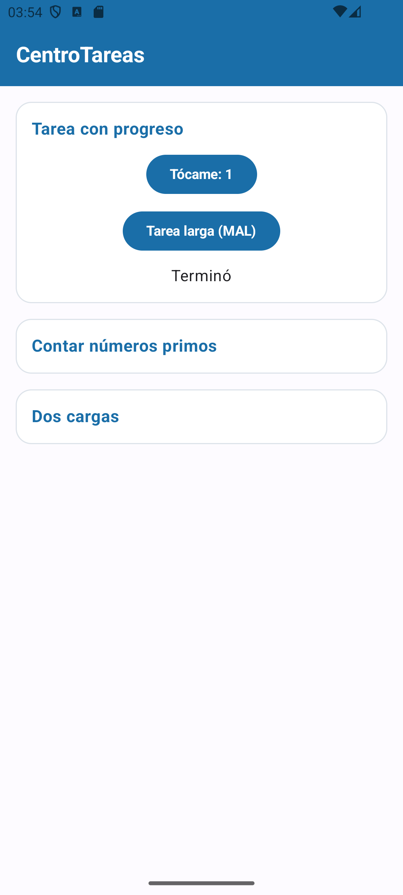
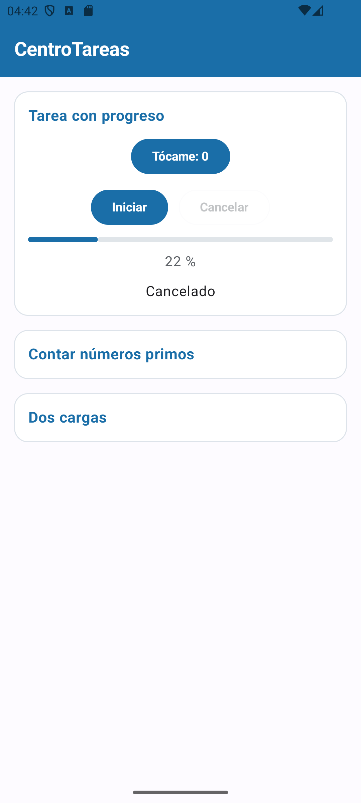
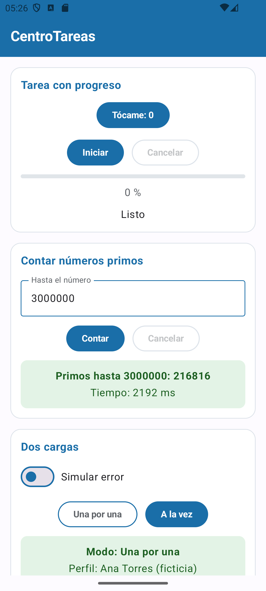
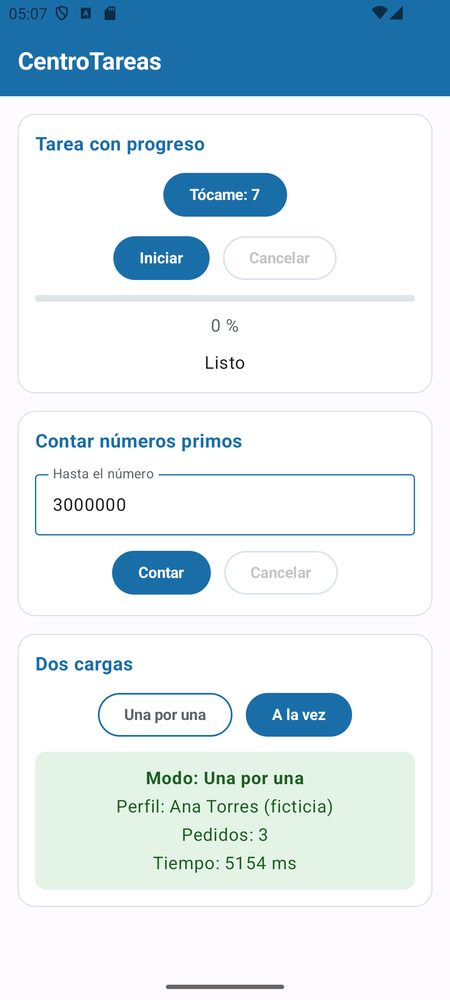
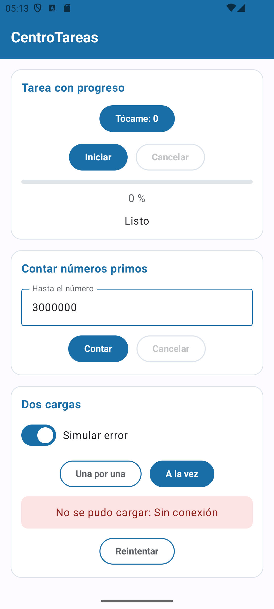

# CentroTareas

**Laboratorio 14 · Hilos en Android** — Programación en Móviles (Tecsup)
**Docente:** Juan León S.
**Estudiante:** Alonso Abad Mejia ([jordanabad797-pixel](https://github.com/jordanabad797-pixel))

## Descripción

CentroTareas es una app Android hecha con **Kotlin + Jetpack Compose + Material 3** (sin XML) que ejecuta tres trabajos que tardan sin congelar nunca la pantalla:

1. **Tarea con progreso:** una tarea de unos 4 s con barra de progreso, que se puede cancelar.
2. **Contar números primos:** un cálculo pesado en `Dispatchers.Default`, que se puede cancelar a mitad.
3. **Dos cargas:** carga simulada de un perfil (2 s) y de pedidos (3 s), una por una o a la vez con `async`, con manejo de errores y reintento.

Usa corrutinas (`viewModelScope`, `launch`, `withContext`, `async`, `Job`), `StateFlow` y la arquitectura **MVVM + Repository**. Todos los datos son ficticios.

## Árbol de paquetes

```
com.tecsup.centrotareas/
├── MainActivity.kt
├── model/
│   └── Estados.kt                    PrimosUi, CargaUi
├── data/
│   ├── TareasRepository.kt           interface
│   └── TareasRepositoryLocal.kt      cargas simuladas y contarPrimos
├── viewmodel/
│   ├── TareasViewModel.kt            progreso, cancelación, primos, cargas y errores
│   └── TareasViewModelFactory.kt
└── ui/
    ├── PantallaTareas.kt             las tres tarjetas
    └── theme/
```

## Arquitectura MVVM + Repository

```
 View (PantallaTareas)
    | eventos: botones              ^ collectAsState()
    v                               |
 ViewModel (TareasViewModel) --- StateFlow --->
    | viewModelScope.launch { ... }
    v
 TareasRepository (interface) ---> TareasRepositoryLocal
                                    (cargas simuladas y contar primos)
```

| Capa | Conoce a | Responsabilidad |
|---|---|---|
| View (`ui/`) | Solo a su ViewModel | Muestra el estado y avisa los eventos. No lanza corrutinas ni usa `Thread` |
| ViewModel | Solo a la interface del Repository | Lanza las corrutinas con `viewModelScope` y expone `StateFlow` de solo lectura |
| Repository | Nada de la UI | Hace el trabajo pesado con funciones `suspend` que no bloquean el hilo que las llama |

## Observación del Paso 1

Al pulsar **Tarea larga (MAL)** la pantalla se congela durante 4 segundos: el botón **Tócame** deja de sumar, ningún botón responde y la interfaz no se vuelve a dibujar hasta que termina la espera.

El texto **Trabajando...** nunca llega a verse porque `Thread.sleep(4000)` se ejecuta en el hilo principal, que es el mismo que dibuja la pantalla. El valor del mensaje sí cambia a «Trabajando...», pero el hilo principal queda bloqueado y no puede redibujar la interfaz. Cuando por fin se libera, el mensaje ya cambió a «Terminó», así que solo se ve el resultado final.

Si la espera fuera de 10 segundos, Android detectaría que la app no responde a los toques durante más de 5 segundos y mostraría el diálogo **ANR (Application Not Responding)**: «CentroTareas no responde», con las opciones de esperar o cerrar la app.

## Capturas

| Paso 1 · Pantalla congelada | Paso 4 · Tarea cancelada | Paso 5 · Contar primos |
|:---:|:---:|:---:|
|  |  |  |

| Paso 6 · Una por una (≈ 5 s) | Paso 6 · A la vez (≈ 3 s) | Paso 7 · Error simulado |
|:---:|:---:|:---:|
|  |  |  |

## Pruebas de aceptación

| Prueba | Resultado esperado | OK |
|---|---|:---:|
| Tarea larga: tocar Tócame mientras trabaja | El contador sigue sumando | ✔ |
| Logcat con filtro HILO | `main` antes y después; `DefaultDispatcher-worker` dentro | ✔ |
| Iniciar la tarea con progreso | La barra avanza de 0 a 100 % en ≈ 4 s | ✔ |
| Cancelar a mitad | La barra se detiene, dice Cancelado y se puede iniciar otra vez | ✔ |
| Pulsar Iniciar dos veces seguidas | No se lanzan dos tareas (el botón está deshabilitado) | ✔ |
| Primos hasta 1000 | Resultado 168 | ✔ |
| Primos con N grande | La pantalla no se congela y Cancelar funciona | ✔ |
| Una por una | ≈ 5 s y resultado correcto | ✔ |
| A la vez | ≈ 3 s y resultado correcto | ✔ |
| Error simulado + Reintentar | Recuadro rojo; al desactivar el interruptor y reintentar, éxito | ✔ |
| Rotar la pantalla durante la tarea | La tarea continúa y el progreso no se reinicia | ✔ |
| Revisar el código | `git grep` no encuentra `GlobalScope`, `runBlocking` ni `Thread.sleep` en el código final | ✔ |

Valores de referencia comprobados: N = 100 → 25, N = 1000 → 168, N = 10 000 → 1229, N = 500 000 → 41 538 y N = 3 000 000 → 216 816 primos. El valor por defecto del campo se ajustó a **3 000 000** porque con 500 000 el emulador tardaba menos de 1 s.

## Para pensar

**1. ¿Por qué no se veía «Trabajando...» en el Paso 1?**
Porque `Thread.sleep(4000)` bloqueaba el hilo principal, que es el único que dibuja la interfaz. El estado cambió a «Trabajando...», pero Compose no tuvo oportunidad de redibujar la pantalla mientras el hilo estaba dormido. Al liberarse, el mensaje ya era «Terminó», y eso fue lo único que se dibujó.

**2. ¿Qué diferencia hay entre `Thread.sleep` y `delay`?**
`Thread.sleep` **bloquea** el hilo completo: durante la espera ese hilo no puede hacer nada más, y si es el principal la app se congela. `delay` **suspende** solo la corrutina: libera el hilo para que atienda otros trabajos (dibujar, responder toques) y la corrutina continúa cuando pasa el tiempo. Además, `delay` es cancelable: si se cancela el `Job`, la espera termina de inmediato con una `CancellationException`.

**3. ¿Por qué `Dispatchers.Default` para los primos y `Dispatchers.IO` para la red?**
Contar primos es trabajo de **CPU**: el procesador está ocupado todo el tiempo. `Dispatchers.Default` tiene tantos hilos como núcleos del procesador, que es lo óptimo para cálculos. La red y el disco son trabajo de **espera**: el hilo pasa la mayor parte del tiempo bloqueado esperando una respuesta. `Dispatchers.IO` tiene un grupo de hilos mucho más grande (hasta 64) para que muchas esperas puedan ocurrir a la vez sin quitarle núcleos a los cálculos.

**4. ¿Qué pasaría con la corrutina si el usuario cierra la pantalla? ¿Qué papel cumple `viewModelScope`?**
`viewModelScope` está atado al ciclo de vida del ViewModel. Si el usuario cierra la pantalla definitivamente, el ViewModel se destruye (`onCleared`) y `viewModelScope` cancela automáticamente todas sus corrutinas, así no quedan trabajos huérfanos ni fugas de memoria. En cambio, si solo **rota** la pantalla, el ViewModel sobrevive al cambio de configuración, así que la corrutina sigue corriendo y el progreso no se reinicia. Por eso no se usa `GlobalScope`, que no se cancela nunca.

**5. ¿Por qué `async` tarda 3 s y no 5 s? ¿Qué pasa si una de las dos cargas falla?**
Con `async` las dos cargas se lanzan al mismo tiempo y corren en paralelo: el perfil (2 s) termina mientras los pedidos (3 s) siguen cargando, así que el total es el de la más lenta, máximo(2 s, 3 s) ≈ 3 s. Una por una, en cambio, se suman: 2 s + 3 s ≈ 5 s. Si una de las cargas falla, gracias a la **concurrencia estructurada** de `coroutineScope` se cancela automáticamente la otra y la excepción se propaga. El `try/catch` del ViewModel la atrapa (dejando pasar antes la `CancellationException`) y muestra el estado `Error` con el botón **Reintentar**, sin que la app se cierre.
